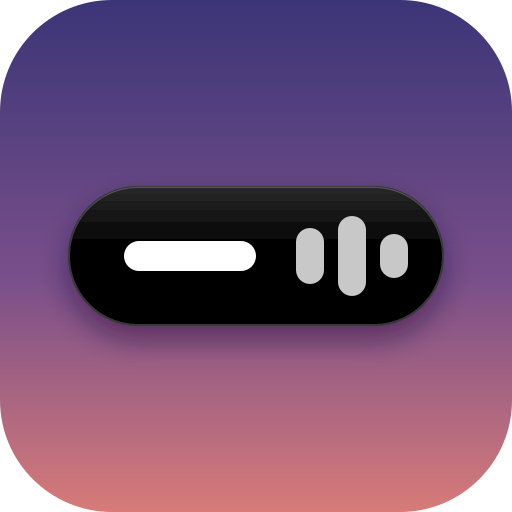

<p align="center">
  
</p>

# Plasma Island

A Dynamic Island–style pill for a KDE Plasma 6 top panel.

- **Resting:** a black pill showing the time, with a small animated equalizer while music plays.
- **Hover:** it springs wider to both sides: weather on the left, date on the right.
- **Click the time:** a matching black card drops below it with what's playing — art, title,
  artist, a progress bar you can click or drag to seek, and previous / play-pause / next.
  Scroll over the card to change the player's volume. Clicking the album art brings the player
  window to the front.
- **Click the weather:** details — condition, feels like, humidity, wind, today's high/low and the
  next six hours. With no city set, the pill says “Set city” and clicking it opens the settings.
- **Click the date:** a month calendar (arrows or scroll to browse) and your world clocks.
- **New track:** the pill briefly widens to show the new title (can be turned off).
- **Middle-click** the pill to play/pause without opening a card.

Click the same spot again, or anywhere else, to close a card.

Media works with anything that speaks MPRIS (Spotify, browsers, VLC, Elisa, mpv…) through
Plasma's own media service, and follows whichever player Plasma considers active.

Weather comes from [Open-Meteo](https://open-meteo.com) (free, no account) and refreshes every
15 minutes. °C or °F follows your system locale; the time format (12h/24h) and date format follow your locale by default and can be changed in the settings.

## Install

```sh
./install.sh
```

Then right-click the top panel → **Add or Manage Widgets** → search **Plasma Island** and drag it
into the panel. Right-click the pill → **Configure Plasma Island…** to set your city, the size
(pill height in px, default 32; the cards scale with it), seconds on the clock and the new-track
popup. The **Time Zones** page adds any number of world clocks (search a city, click to add,
reorder with the arrows).
You can also hold **Ctrl** and scroll over the pill to resize it live.

To center it, put a **Flexible Spacer** on each side of it (panel edit mode → Add Spacer).
Spacers center it in the space left over, so it sits exactly at the middle of the screen only when
the things on its left and right are the same width.

You'll probably want to remove Plasma's Digital Clock from the panel as well.

## Update

```sh
git pull && ./install.sh
systemctl --user restart plasma-plasmashell   # Plasma caches the old QML until it restarts
```

## Uninstall

```sh
kpackagetool6 -t Plasma/Applet -r io.github.luminarysrc.plasmaisland
```

## Notes

- Built for a horizontal (top) panel.
- The pill reserves its widened width in the panel, so the neighbouring widgets don't shift while it
  animates.
- Uses `org.kde.plasma.private.mpris`, Plasma's private media module (the same one the built-in
  Media Player widget uses). A future Plasma release could change it.
