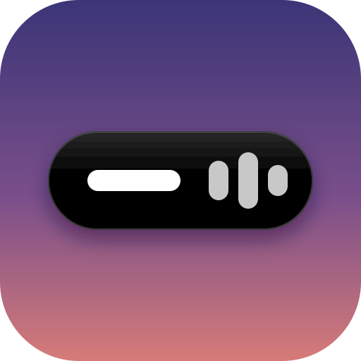
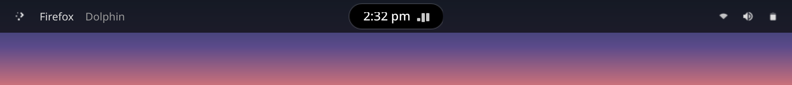
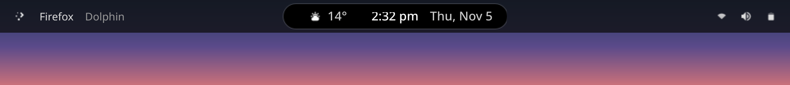
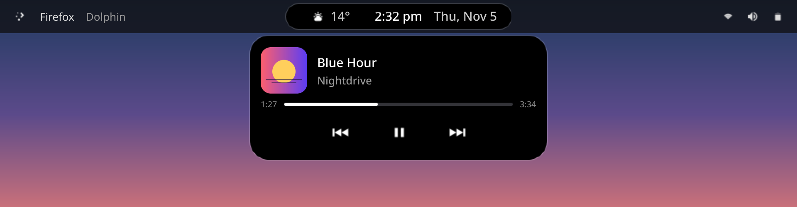
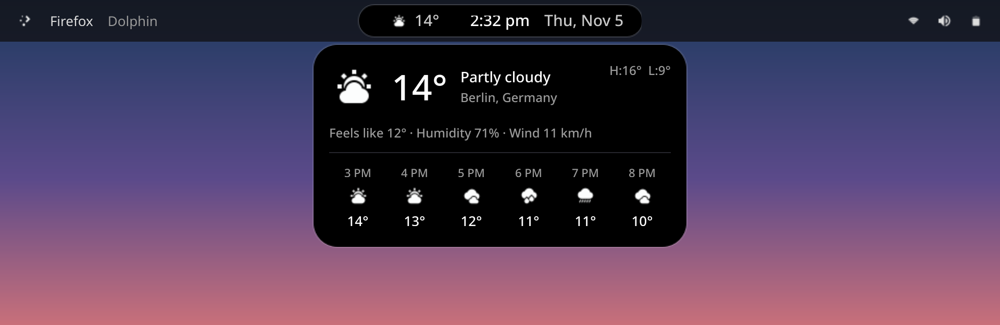
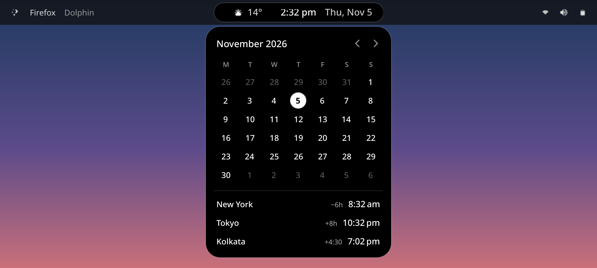

<p align="center">
  
</p>

# Plasma Island

A Dynamic Island–style pill for a KDE Plasma 6 top panel.

**[Get it on the KDE Store](https://store.kde.org/p/2381160/)** · or in Plasma: *Add Widgets → Get New Widgets → Download New Plasma Widgets* → search “Plasma Island”.

| Resting | Hover |
|---|---|
|  |  |





- **Resting:** a black pill showing the time, with a small animated equalizer while music plays.
- **Hover:** it springs wider to both sides: weather on the left, date on the right.
- **Click the time:** a matching black card drops below it with what's playing — art, title,
  artist, a progress bar you can click or drag to seek, and previous / play-pause / next.
  Scroll over the card to change the player's volume. Clicking the album art brings the player
  window to the front.
- **Click the weather:** details — condition, feels like, humidity, wind, today's high/low and the
  next six hours. With no city set, the pill says “Set city” and clicking it opens the settings.
- **Click the date:** a month calendar (arrows or scroll to browse) and your world clocks.
- **New track:** the pill briefly widens to show the new title (can be turned off).
- **Middle-click** the pill to play/pause without opening a card.

Click the same spot again, or anywhere else, to close a card.

Media works with anything that speaks MPRIS (Spotify, browsers, VLC, Elisa, mpv…) through
Plasma's own media service, and follows whichever player Plasma considers active.

Weather comes from [Open-Meteo](https://open-meteo.com) (free, no account) and refreshes every
15 minutes. °C or °F follows your system locale; the time format (12h/24h) and date format follow your locale by default and can be changed in the settings.

## Install

From the [KDE Store](https://store.kde.org/p/2381160/) (see above), or from source:

```sh
./install.sh
```

Then right-click the top panel → **Add or Manage Widgets** → search **Plasma Island** and drag it
into the panel. Right-click the pill → **Configure Plasma Island…** to set your city, the size
(pill height in px, default 32; the cards scale with it), the language, a transparent background
(text only, in your panel's colours), the time and date format — 12/24-hour, several date styles,
or your own Qt format such as `HH:mm:ss` or `yyyy-MM-dd`, independent of the system locale —
seconds on the clock and the new-track popup. The **Time Zones** page adds any number of world clocks (search a city, click to add,
reorder with the arrows).
You can also hold **Ctrl** and scroll over the pill to resize it live.

To center it, put a **Flexible Spacer** on each side of it (panel edit mode → Add Spacer).
Spacers center it in the space left over, so it sits exactly at the middle of the screen only when
the things on its left and right are the same width.

You'll probably want to remove Plasma's Digital Clock from the panel as well.

## Translations

Plasma Island is translated into Greek, Spanish, German and Russian (it follows your system language).
To add or fix a language, edit or copy a file in [`po/`](po) (e.g. `po/fr.po` from
`po/plasma_applet_io.github.luminarysrc.plasmaisland.pot`) and open a pull request. `./install.sh`
compiles them with `msgfmt` (from gettext).

## Languages

English, Русский, Español, Deutsch and Ελληνικά. By default the widget follows your Plasma
language; **Configure → Language** overrides it for this widget only (cards, settings, month and
weekday names, and the place name in the weather). The translations were made with AI; corrections
are welcome — edit the `po/<lang>.po` file and open a pull request.

Plasma applies one language to the whole shell, so the widget carries its own copy of the
strings: `po/gen-js.py` turns `po/*.po` into `package/contents/ui/Translations.js`. `./install.sh`
and `./package.sh` run it (through `po/build.sh`), and the generated file is committed.
To add a language, copy `po/plasma_applet_io.github.luminarysrc.plasmaisland.pot` to `po/<lang>.po`,
translate it, and add the language to the list in `package/contents/ui/configGeneral.qml`.

## Update

```sh
git pull && ./install.sh
systemctl --user restart plasma-plasmashell   # Plasma caches the old QML until it restarts
```

## Uninstall

```sh
kpackagetool6 -t Plasma/Applet -r io.github.luminarysrc.plasmaisland
```

## Releasing to the KDE Store

1. Bump `Version` in `package/metadata.json` (the store and “Get New Widgets” detect updates by it).
2. `./package.sh` builds `plasma-island-<version>.plasmoid`, translations included. Don't zip
   `package/` by hand: the compiled translations are generated, not committed.
3. Upload the file as a new version of the existing store page. Never change `Id`.

## Notes

- Built for a horizontal (top) panel.
- At rest the widget takes only the width of the time and grows as the pill opens. With flexible
  spacers on both sides the pill stays centred; if you'd rather the neighbouring widgets never move,
  turn on **Panel space → Always reserve room for the expanded pill**.
- Uses `org.kde.plasma.private.mpris`, Plasma's private media module (the same one the built-in
  Media Player widget uses). A future Plasma release could change it.
